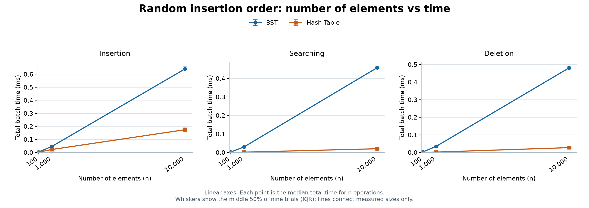
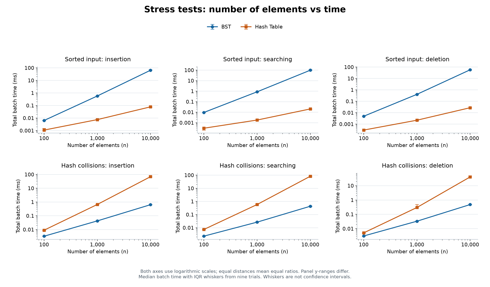
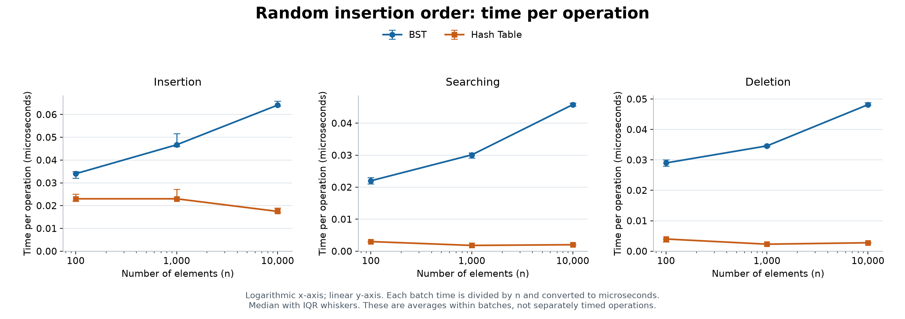

# BST and Hash Table Performance Report

## Aim

In this project, I compare a Binary Search Tree (BST) and a Hash Table. I implement insertion, searching and deletion in Java. I test both structures with 100, 1,000 and 10,000 elements to see how the input changes their performance.

## Implementation

Both structures store unique integer keys. `insert` returns `false` for a duplicate, `contains` checks if a key exists, and `delete` returns `false` if the key is missing. They also have a `size` method. Java collections are only used as a reference in the correctness tests.

- [BinarySearchTree.java](src/BinarySearchTree.java): a normal BST without automatic balancing. Smaller keys go to the left and larger keys go to the right. Insertion follows a path to an empty position. Searching compares the key with each node on the path. Deletion removes a leaf, connects a node's child to its parent, or replaces a key with the smallest key in its right subtree when it has two children. The operations use loops, so a long tree does not cause recursive stack overflow.
- [HashTable.java](src/HashTable.java): an array of buckets with linked lists for collisions. The bucket index is `Math.floorMod(key, capacity)`, which also handles negative integers. The table starts with 16 buckets. It doubles its capacity when a new insertion would make the load factor greater than 0.75. The load factor is the number of keys divided by the number of buckets. Resizing moves all existing entries to their new buckets. Insertion checks for a duplicate before adding a key. Searching walks through one bucket's list. Deletion finds the key and removes it from that list. The table does not shrink.

Example:

```java
IntSet tree = new BinarySearchTree();
IntSet table = new HashTable();
tree.insert(20);
table.insert(20);
System.out.println(tree.contains(20));
System.out.println(table.delete(20));
```

## Time complexity

Here, `n` is the current number of keys and `h` is the height of the BST. These values describe **one operation**, not a full experiment.

| Structure | Operation | Best case | Expected case under suitable input | Worst case |
| --- | --- | --- | --- | --- |
| BST | Insertion | O(1) | O(log n) | O(n) |
| BST | Searching | O(1) | O(log n) | O(n) |
| BST | Deletion | O(1) | O(log n) | O(n) |
| Hash Table | Insertion | O(1) | O(1), amortized | O(n) |
| Hash Table | Searching | O(1) | O(1) | O(n) |
| Hash Table | Deletion | O(1) | O(1) | O(n) |

BST operations take O(h + 1) time. A best-case search finds the root. A best-case insertion uses an empty tree or an empty child near the root. A best-case deletion removes the root when it has at most one child. Finding the root is not enough for constant-time deletion if finding its successor still takes a long path.

With keys inserted in random order, the expected height is O(log n). A balanced tree also has logarithmic height. However, this implementation does not guarantee balance. Sorted insertion creates a chain, so reaching a deep key can take O(n) time. Even in a balanced tree, a single search for the root is O(1); O(log n) describes the height-based bound, not every operation's best case.

Hash Table operations are fast when keys spread well between buckets and the load factor stays small. The best case needs only a constant number of steps and no resize. Expected insertion is **amortized** O(1): most insertions are cheap, but an occasional resize takes O(n). The resize cost is spread across many insertions. If all keys go to one bucket, searching or deleting a key near the end takes O(n). In this implementation, insertion also takes O(n) in that situation because it first checks the chain for duplicates. Resizing cannot fix keys that still map to the same bucket.

Both structures use O(n) space while they hold n keys after construction. The Hash Table also has its bucket array. After deletion, its array keeps its previous capacity, so its retained space depends on the largest size it reached.

## Experiment method

The experiment ran on Windows 11 with an Intel Core i5-13450HX and OpenJDK 25.0.1. It used one thread and a 256 MiB JVM heap. The [environment file](results/environment.txt) records the run details.

I used three inputs:

1. **Random order:** the unique keys `0` to `n - 1` are shuffled. This gives a random BST shape. With this particular hash function, the keys occupy separate buckets after all insertions, so this is a favorable Hash Table workload.
2. **Sorted order:** the same keys are inserted from smallest to largest. This creates a chain in the BST.
3. **Collisions:** shuffled keys are multiples of the final Hash Table capacity: 256, 2,048 or 16,384 for the three sizes. All these keys map to bucket zero, including before resizing. Their shuffled order still gives the BST a random shape. This is a deliberate stress test, not typical random data.

Both structures receive exactly the same keys and operation order in each trial. Every trial starts with an empty structure, inserts n keys, searches successfully for all n keys, and deletes all n keys. Search and deletion orders are independently shuffled. Deletion is a batch that gradually empties the structure; it is not n operations on a table that always stays the same size. Missing-key operations are checked in the tests but are not timed here.

I used `System.nanoTime()` to measure each full batch. Input generation, object construction and file writing are outside the timed sections. Node allocation, duplicate checks and Hash Table resizing during insertion are included. The program checks the success counts and final sizes outside each timed section.

Before collecting results, the program runs 2,000 random 1,000-element warmups per structure. It then uses three warmups and nine measured trials for each input and size. The tables show the **median of nine batch times in milliseconds**. A median is the middle value after sorting the nine times. The seed formula is `42 + 1009 * n + trial`. The order of the two structures alternates between trials. `-Xbatch` makes Java compilation happen in the foreground, helping warmup finish before measurement.

These are small coursework measurements from one JVM run, not a full benchmark across different computers. Short batches, especially with 100 keys, are sensitive to timer resolution and system activity. Warmup and medians reduce noise but do not remove it. The raw results include occasional slow trials. Small differences should not be treated as a universal ranking.

## Measured results

Each row reports the total time for n insertions, n searches or n deletions. For example, O(1) expected time for one Hash Table search means about O(n) total time for a batch of n searches.

### Random insertion order

| Elements | Structure | Insert (ms) | Search (ms) | Delete (ms) |
| ---: | --- | ---: | ---: | ---: |
| 100 | BST | 0.0034 | 0.0022 | 0.0029 |
| 100 | Hash Table | 0.0023 | 0.0003 | 0.0004 |
| 1,000 | BST | 0.0467 | 0.0301 | 0.0346 |
| 1,000 | Hash Table | 0.0230 | 0.0018 | 0.0023 |
| 10,000 | BST | 0.6411 | 0.4579 | 0.4814 |
| 10,000 | Hash Table | 0.1746 | 0.0202 | 0.0277 |

The Hash Table was faster for all three operations in this workload. With 10,000 elements, the search batch took 0.4579 ms for the BST and 0.0202 ms for the Hash Table. The BST followed several nodes for many searches, while the Hash Table could find each key in its own bucket.

### Sorted insertion order

| Elements | Structure | Insert (ms) | Search (ms) | Delete (ms) |
| ---: | --- | ---: | ---: | ---: |
| 100 | BST | 0.0064 | 0.0095 | 0.0049 |
| 100 | Hash Table | 0.0011 | 0.0003 | 0.0003 |
| 1,000 | BST | 0.5743 | 0.8722 | 0.4075 |
| 1,000 | Hash Table | 0.0075 | 0.0018 | 0.0022 |
| 10,000 | BST | 64.8738 | 99.1224 | 57.8554 |
| 10,000 | Hash Table | 0.0782 | 0.0205 | 0.0274 |

Sorted input made the BST much slower. Building the chain requires roughly 1 + 2 + ... + (n - 1) comparisons, so the full insertion batch takes O(n squared) time. Searching every key in that chain also takes O(n squared) total time. The shuffled deletion batch has quadratic expected total work because many deletions still follow long paths. Deleting the root repeatedly would be a different and much cheaper workload.

### Deliberate hash collisions

| Elements | Structure | Insert (ms) | Search (ms) | Delete (ms) |
| ---: | --- | ---: | ---: | ---: |
| 100 | BST | 0.0033 | 0.0023 | 0.0031 |
| 100 | Hash Table | 0.0090 | 0.0074 | 0.0051 |
| 1,000 | BST | 0.0426 | 0.0267 | 0.0332 |
| 1,000 | Hash Table | 0.6635 | 0.5848 | 0.3012 |
| 10,000 | BST | 0.6401 | 0.4327 | 0.4819 |
| 10,000 | Hash Table | 69.1722 | 82.8891 | 40.7705 |

When all keys entered one bucket, the Hash Table became much slower. With 10,000 keys, its search batch took 82.8891 ms, compared with 0.4327 ms for the BST. The long collision chain gives quadratic total work for inserting or searching all n keys. Random deletion from the chain also has quadratic expected total work. The BST still received a shuffled insertion order.

## Graphs made with Python

The graphs use the saved measurements in `results/raw.csv`. The Python script also checks that their medians match `results/summary.csv`. Blue shows the BST, and orange shows the Hash Table. Each point is the median of nine trials. The small vertical lines show the middle 50% of the measured times, called the interquartile range (IQR). They show variation between trials, not a confidence interval. Lines connect the three tested sizes; no extra sizes were measured.

### Number of elements vs execution time



Both axes are linear. The x-axis shows 100, 1,000 and 10,000 elements. The y-axis shows the total time for all n operations in milliseconds. The Hash Table was faster for all three operations in this input. Each panel has its own y-axis range.

### Sorted input and hash collisions



The top row shows sorted input, which makes the BST much slower. The bottom row shows deliberate collisions, which make the Hash Table much slower. Both axes use logarithmic scales so that large and small times are visible together. On a logarithmic scale, equal distances show equal ratios, for example, from 100 to 1,000 and from 1,000 to 10,000. Each panel has its own y-axis range. These graphs show measured trends; three input sizes alone cannot prove a time complexity.

### Time per operation



This graph divides each batch time by n. The y-axis shows microseconds per operation, and the x-axis is logarithmic. The BST's time per operation increases as the input grows. The Hash Table stays relatively low in this favorable workload. These values are averages within each batch. Individual operations were not timed separately, and deletion gradually reduces the structure's size.

### Generate the graphs

Use Python 3.12 and install Matplotlib. The saved graphs were generated with Matplotlib 3.11.2.

```powershell
python -m pip install -r requirements.txt
python scripts/plot_results.py
```

The script saves three PNG images and three SVG versions in `results/plots/`. PNG files appear in this README. SVG files stay sharp when resized. Run the script again after collecting new benchmark results to update the graphs.

## Why performance differs in practice

- **Tree shape:** a short BST needs fewer comparisons. Sorted input makes this unbalanced BST tall.
- **Hash distribution:** short bucket lists give fast access. Long collision lists remove this advantage. A small load factor alone does not guarantee a good distribution.
- **Resizing:** allocating a bigger array and moving entries takes time. This is included in the Hash Table insertion results.
- **Memory access:** both implementations use linked objects. Following references can require extra memory reads. The Hash Table also uses an array of bucket references.
- **Java and the computer:** runtime compilation, memory allocation, garbage collection, processor caches and background work can change measured times. The exact size of these effects was not measured separately.

## Conclusion

The Hash Table was faster with the normal shuffled keys in this experiment. The BST became much slower with sorted insertion, and the Hash Table became much slower with deliberate collisions. Therefore, the best choice depends on the input and the task. I would choose a Hash Table for fast exact-key lookup when keys spread well. A BST keeps keys in order, which can support sorted traversal and range queries, although these extra operations are not implemented here. If I needed reliable logarithmic tree performance, I would use a balanced BST such as an AVL tree.

## Run and verify

Use a JDK with both `javac` and `java` on PATH. Use the same JDK for compilation and execution. This submission was compiled and tested with JDK 25.0.1.

From the project folder in PowerShell:

```powershell
New-Item -ItemType Directory -Force build | Out-Null
javac -d build src\*.java
java -cp build Tests
java -Xbatch -Xms256m -Xmx256m -cp build Benchmark
```

On the computer used for this report, the JDK was outside PATH. These commands select it directly:

```powershell
$jdk = "$env:USERPROFILE\.jdks\openjdk-25.0.1\bin"
New-Item -ItemType Directory -Force build | Out-Null
& "$jdk\javac.exe" -d build src\*.java
& "$jdk\java.exe" -cp build Tests
& "$jdk\java.exe" -Xbatch -Xms256m -Xmx256m -cp build Benchmark
```

The recorded test result is **PASS: 186218 checks**. Tests cover empty structures, duplicate keys, missing keys, negative and extreme integers, BST deletion cases, resizing and collisions. They also compare 30,000 random operations per structure with Java's `HashSet`, and test 10,000 sorted BST keys and 10,000 colliding Hash Table keys.

Running the benchmark replaces the CSV and environment files. New times will differ; the tables above describe the saved run, so update them if you replace the saved results.

## Submission files

- [Source code](src/)
- [Raw measurements: 486 rows](results/raw.csv)
- [Summary: 54 rows, with median, minimum and maximum times](results/summary.csv)
- [Execution environment](results/environment.txt)
- [Python plotting script](scripts/plot_results.py)
- [Graphs in PNG and SVG formats](results/plots/)
- [Short report to copy by hand](handwritten-report.txt)

The short report is a draft for handwriting. Read it, make sure you can explain each point, and adjust the wording to match your own understanding.
